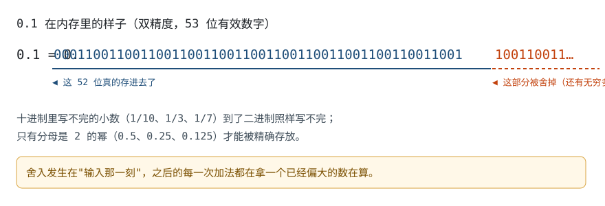

# 为什么计算机算错了 0.1 + 0.2

> 这是一份**示例讲义**，用来说明 lecture-forge 生成的讲义长什么样：从"一个算不对的问题"开始，把每一步的"为什么"讲透，最后给自测题。
> 主题和本项目无关，你可以直接删掉 `examples/demo-lecture`。

---

## 一、先看一个"算错了"的程序

任何一门语言的解释器里，输入下面这一行，都会得到同样的结果：

```
0.1 + 0.2  →  0.30000000000000004
```

不是 `0.3`。而且更诡异的是：

```
0.1 + 0.2 == 0.3      →  False
0.1 + 0.2 - 0.3       →  5.551115123125783e-17
```

第一反应通常是"浮点数不准"。但"不准"是个形容词，不是一个解释。真正要回答的是三个问题：

- 为什么偏偏是这几位错？
- 错多少？这个误差会不会越算越大？
- 写代码时到底该怎么办？

这一篇从头到尾只回答这三个问题。

---

## 二、先把工具备好：计算机其实只会数二进制

计算机存小数用的是 **浮点数**，本质是二进制版的科学计数法：

```
数值 = 符号 × 尾数 × 2^指数
```

以双精度（float64，日常语言里的 float）为例，一共 64 位：1 位符号、11 位指数、52 位尾数。
关键在"52 位尾数"：它只能保留 **53 位有效二进制数字**（隐含一位前导 1），
再多的小数位就被**四舍五入**掉了。

所以问题变成一句话：**0.1 用二进制写出来，是不是有限的？**

---

## 三、为什么 0.1 在二进制里写不完

十进制的"写不完"来自分母含 3、7 这类质因子；二进制的规则更简单：**只要分母不是 2 的幂，就一定写不完。**

- 0.5 = 1/2 → 0.1₂，有限；
- 0.25 = 1/4 → 0.01₂，有限；
- 0.1 = 1/10 → 分母含质因子 5，**写不完**。

连续乘 2 取整数部分，就能看出循环节：

```
0.1 × 2 = 0.2  取 0  → 0.0
0.2 × 2 = 0.4  取 0  → 0.00
0.4 × 2 = 0.8  取 0  → 0.000
0.8 × 2 = 1.6  取 1  → 0.0001
0.6 × 2 = 1.2  取 1  → 0.00011
0.2 × 2 ...     回到第一步，开始循环
```

于是 `0.1 = 0.0001100110011001100…₂`，`1100` 无限循环。0.2 只是把小数点右移一位：
`0.2 = 0.00110011001100…₂`。两者同样写不完。



*▲ 自绘：存进去的只有前面 53 位，后面全部被舍掉——误差就是从这一步产生的*

---

## 四、算一笔账：错多少

把 `0.1` 截到 53 位，被舍掉的是一个正数（因为后面还有 1），所以存进去的值**比 0.1 略大**：

```
0.1 存成     0.1000000000000000055511151231257827…
0.2 存成     0.2000000000000000111022302462515654…
相加         0.3000000000000000444089209850062616…
真实值       0.3
```

差的 `4.44 × 10⁻¹⁷` 被打印成 `…04`，是因为打印时取了"最短能唯一还原这个数"的形式。
注意：**误差不是"随机噪声"，它是确定的**——同样的输入，误差永远是同一串数字。

所以 `0.1 + 0.2 - 0.3` 得到 `5.55 × 10⁻¹⁷`，而不是 0。

> 这里有个容易混的点：`5.55e-17` 和上面那个 `4.44e-17` 不是同一个数。前者是"两个已经存错的数相加后再减 0.3"的结果，后者只是 `0.3` 这一个数存错的偏差。两个误差方向不同，相减后剩下 `5.55e-17`。

---

## 五、误差会不会越算越大

会，但方向取决于你怎么算。

- **加减同一量级的数**：误差是"绝对"的，约 `10⁻¹⁷` 量级，通常无害。
- **大数吃小数**：`(1e16 + 1) - 1e16` 得到 `0`，因为 `1` 在 53 位有效数字里被挤掉了。
- **反复累加**：每加一次都可能丢一点，循环一百万次能把误差累到肉眼可见。

一句话：**浮点误差不可怕，量级失控才可怕。**

---

## 六、那写代码时怎么办

按场景选，不要背口诀：

1. **比较大小**：不要用 `==`，用"差小于一个容差"。容差要按数值量级取，例如 `1e-9 * max(1, |a|, |b|)`。
2. **钱、库存、计数**：全部换成整数（以"分"为单位），或者用十进制库（Python 的 `decimal`、Java 的 `BigDecimal`）。
3. **科学计算**：接受误差，改用"误差传播"的思路估上界，别指望精确相等。
4. **`round()` 不是万能的**：Python 里 `round(2.675, 2)` 得到 `2.67`，因为 `2.675` 本身存的就是 `2.67499999…`。

---

## 七、自测 3 题

先自己写答案，再展开。

<details><summary>1. 为什么 0.5 没有这个问题，0.1 有？</summary>
0.5 = 1/2，分母是 2 的幂，二进制里是有限的 0.1₂，53 位足够放下，不产生舍入。0.1 = 1/10，分母含质因子 5，二进制展开无限循环，必然被舍。
</details>

<details><summary>2. 有人说"那就用 float 时多保留几位小数就好了"，哪里不对？</summary>
问题不在打印几位，而在**存储**只有 53 位有效数字。多打印几位只会把已经存在的误差暴露出来，不会减少误差。要消除它只能换表示法（整数/十进制）。
</details>

<details><summary>3. 判断：既然误差只有 10⁻¹⁷，那么累加一亿次也没事。</summary>
错。误差会累积；如果每次丢掉的量级相近、方向相同，一亿次后就是 10⁻⁹ 量级，某些场景（金融、导航、迭代收敛判断）已经不能接受。正确做法是改用可交换的累加方式（如 Kahan 求和）或换数据类型。
</details>

---

## 最后，一句话记住这一讲

**浮点数不是"不准的十进制"，它是"精确的二进制"——你输入的那个十进制小数，从进门那一刻就已经被改写成了另一个数。**
